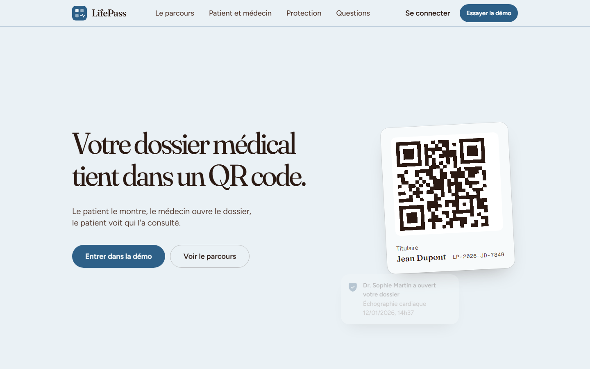
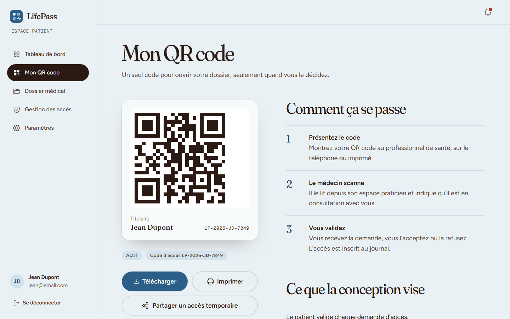
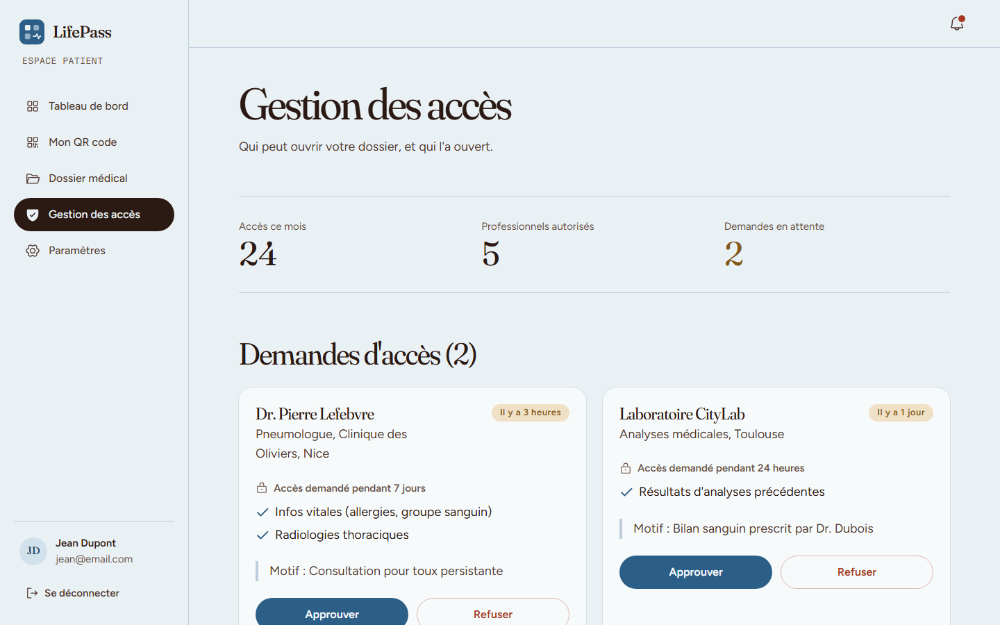

# LifePass

**A patient's medical record in one QR code, opened by a doctor only with the patient's consent.**

[](https://lifepass-sandy.vercel.app)
[](https://github.com/FARUKxKUN/LifePass/actions/workflows/ci.yml)


**1st place at the DevHeist hackathon (ISIMa, February 2026).** Redesigned in October 2026. The version presented at the hackathon is tagged [`hackathon-2026-02`](https://github.com/FARUKxKUN/LifePass/tree/hackathon-2026-02).



---

## The problem

A patient's history is scattered: lab results at the lab, prescriptions at the GP, scans at the radiologist. In an emergency, nobody knows their allergies or current treatments, and the patient rarely has the paperwork on them. Sharing records today means carrying folders or forwarding files with no control over who sees what.

## What LifePass does

1. The patient keeps their record in one place: reports, prescriptions, allergies, treatments, history.
2. They show their personal QR code, on their phone or on paper.
3. The doctor scans it and sends an access request with a reason, a duration and the parts of the record they need.
4. The patient approves or refuses in one tap, and can choose the access level (full, cardiology only, limited, targeted).
5. The doctor sees the record and can add a new report to it.
6. Every opening is written to an access log the patient can read: who, when, which document, for how long.



## Highlights

- **Consent first.** Nothing opens on a scan alone: every access is a request the patient decides on, with a reason, a duration and a scope. Access can be withdrawn at any time.
- **Graded access.** Four access levels, so a cardiologist can see the cardiology file without seeing everything else.
- **A log the patient owns.** Every access is listed with the professional, the document opened and the duration.
- **Two complete sides.** A patient space (dashboard, records, QR pass, access log, settings) and a doctor space (scan, patient view, add a report, recent patients).
- **Accessible.** Full keyboard navigation with managed focus in sheets and dialogs, and animations that respect `prefers-reduced-motion`.
- **Calm, clinical design.** A restrained palette and editorial type, built to feel trustworthy rather than flashy, and readable for older patients.



## Tech stack

| Layer | Technology |
|---|---|
| App | React 18, TypeScript, Vite |
| Routing | React Router (separate patient and doctor layouts) |
| Styling | Tailwind CSS v4 with CSS-first design tokens |
| Motion | motion (springs, sheets) and GSAP ScrollTrigger (landing page) |
| QR | qrcode.react |
| Icons and type | Phosphor icons, Fraunces, Figtree and Geist Mono (self-hosted) |
| Hosting | Vercel |

## Project structure

```
src/
  pages/patient/    Dashboard, MedicalRecords, QRCode, AccessLogs, Settings
  pages/doctor/     Dashboard, ScanQR, PatientView, AddReport
  components/
    landing/        Hero, Problem, Handoff, Sides, Protection, Faq, Team
    app/            AppShell, QrPass, NotificationCenter, Assistant
    ui/             Button, Sheet, Tabs, Toast, Field and other primitives
  context/          AuthContext (demo sign-in, kept in sessionStorage)
  data/mockData.ts  Patients, doctors, reports, access logs and requests
  types.ts          Domain model: records, access levels, requests, logs
```

## Run locally

```bash
npm install
npm run dev     # http://localhost:5173
npm run build   # type check + production build
```

Demo accounts (password `demo1234`):

| Role | Email |
|---|---|
| Patient | `jean@email.com` |
| Patient | `marie@email.com` |
| Doctor | `dr.martin@email.com` |
| Doctor | `dr.dubois@email.com` |

## Status

This is the clickable prototype, redesigned. Everything runs in the browser with mock data: there is no back end, no real camera (the doctor's scan is simulated) and no real medical data. It is not a medical product and is not compliant with any health-data regulation. The UI is in French.

## Team

| | Role |
|---|---|
| [Rayen Chatti](https://github.com/rayenchatti) | Concept, pitch deck design |
| [Yassine Bouteraa](https://github.com/yassinebouteraa) | Concept, pitch deck design, pitch |
| **Farouk Battikh** ([@FARUKxKUN](https://github.com/FARUKxKUN)) | Prototype and its redesign, pitch |

## License

No license is granted. All rights reserved by the team.
